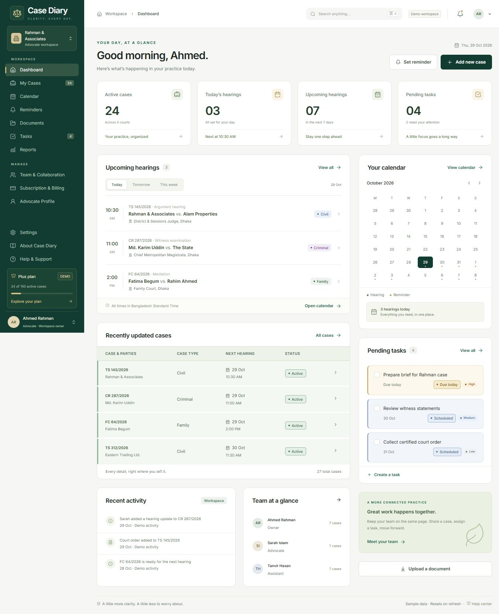
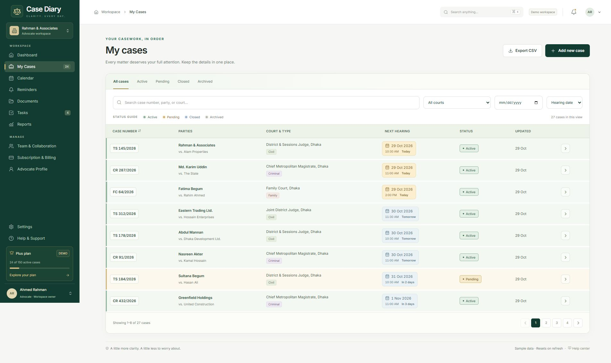
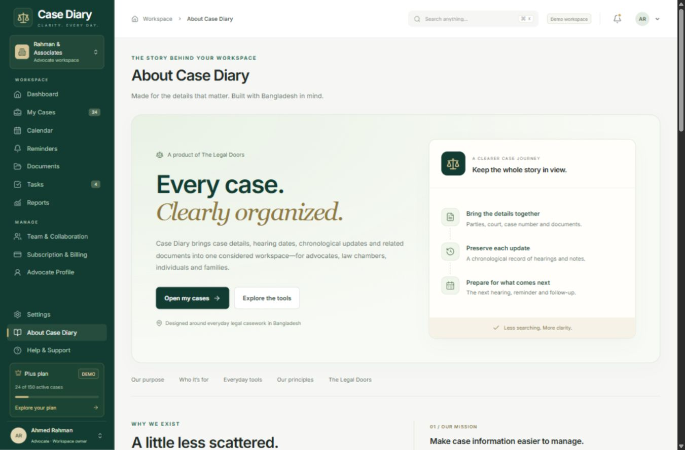
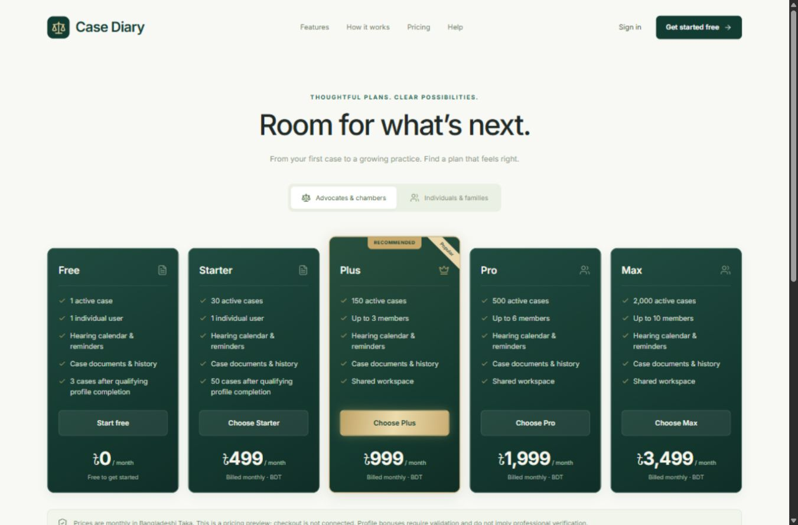

# Case Diary

A responsive legal case-management experience designed around the day-to-day needs of advocates, law chambers, individuals, and families in Bangladesh. Built with React, TypeScript, Vite, Lucide, and locally bundled Inter fonts.

<p align="center">
  
</p>

## Why Case Diary matters

Important case details can end up scattered across notes, calendars, documents, and conversations. That can make it harder to see what needs attention next, keep a reliable history, or coordinate with the people involved.

Case Diary brings case details, hearing dates, chronological updates, related documents, reminders, and tasks together in one clear workspace. It is designed to make everyday case administration easier to follow, help people prepare for upcoming work, and give advocates and clients a more organized view of a case journey.

### Intended impact

- **A clearer picture of what is next:** hearing dates, reminders, and pending tasks are visible alongside case information.
- **Less fragmented record-keeping:** case details and chronological updates have a consistent place.
- **Better coordination:** workspace and sharing previews show how teams, individuals, and families could work around the same case information.
- **More approachable legal administration:** plain-language guidance and a dedicated common-person experience make the interface useful beyond a law chamber.

These are the goals of this product demonstration, not measured real-world outcomes. Case Diary is not legal advice and is not yet a production record system; it uses sample data that resets on refresh.

## Project screenshots

<p align="center">
  
  
</p>

<p align="center">
  
</p>

## Run locally

Requires Node.js 22.12+ (tested on Node 24.19).

### Open the downloaded project in VS Code

1. Extract the ZIP completely. Open its inner `Case-Diary` folder in VS Code with **File → Open Folder**. This is the folder containing `package.json`.
2. Install Node.js if needed, then restart VS Code so its terminal can find `node` and `npm`.
3. Open **Terminal → New Terminal** and run the following commands from that project folder:

```sh
npm install
npm run dev
```

Open the local URL printed by Vite, normally `http://127.0.0.1:5173/`.

Keep the terminal running while using the design; press **Ctrl+C** to stop the server. If port 5173 is already in use, Vite prints the alternative port it selected. Opening `index.html` directly is not supported; use the Vite URL.

On Windows, if PowerShell blocks `npm.ps1`, select a **Command Prompt** terminal in VS Code or use `npm.cmd install` and `npm.cmd run dev`. No `.env` file, API keys or database setup is needed for this frontend demo. Internet access is needed for the first dependency installation. `node_modules`, build output and temporary files are intentionally excluded from the source ZIP; `npm install` and `npm run build` recreate them. `package-lock.json` is included; use `npm ci` instead of `npm install` when you want the exact locked dependency versions.

### Optional checks and production preview

```sh
npm test
npm run lint
npm run typecheck
npm run build
npm run preview
```

## Screens

| Area | Routes |
| --- | --- |
| Public website | `/welcome`, `/pricing`, `/privacy`, `/terms` |
| Account previews | `/signin`, `/register`, `/forgot-password`, `/onboarding` |
| Daily workspace | `/` (dashboard), `/cases`, `/shared`, `/calendar` |
| Case workflows | `/cases/new`, `/cases/:id`, `/cases/:id/edit` |
| Productivity | `/reminders`, `/documents`, `/tasks`, `/reports` |
| Administration | `/team`, `/billing`, `/profile`, `/settings`, `/about`, `/help` |

The dashboard opens first for easy UI review. Use the top-right account menu to switch between the Advocate / Law Chamber and Common Person experiences or visit the public website. Each account type has separate sample data.

Open `/signin` for one-click **Common person** and **Advocate** demo sign-in. No credentials are required; each button opens its own sample workspace. Public “Explore the demo” links lead to this chooser.

Registration, the full month calendar, reports, and subscription overview use compact desktop layouts. Verified at 1920 × 945, 1366 × 680 and 1150 × 680 browser viewports. Smaller screens and browser zoom retain natural scrolling. Calendar dates open a paginated daily schedule; reports paginate growing lists; billing details and payment history open in a dialog.

## Design

Forest green `#123B32`, dark green `#0B2923`, restrained champagne gold `#C8A96B`, warm white `#F6F7F4`, and white bordered panels. Shared buttons, badges, forms, dialogs, tables, avatars, timelines, and calendar components maintain consistency. Mobile navigation collapses, case tables become cards, and the calendar becomes an agenda. Keyboard focus, reduced-motion preferences, semantic forms, native modal focus containment, and keyboard tab navigation are supported.

## Working local interactions

- Create and edit cases, validate required/duplicate fields, close/archive with confirmation, and preserve case history.
- Append hearing updates, show the next date, and format timestamps in Bangladesh time.
- Search, combine filters, sort, paginate, reset filters, and export cases to CSV with spreadsheet-formula protection.
- Browse month/week/day calendars and follow case links. Create and complete reminders and tasks.
- Add documents to browser memory, validate type and 10 MB size limits, filter files, switch grid/list, preview supported files, and download. Word files offer download instead of pretending to preview.
- Calculate reports from the current workspace records and export JSON.
- Prepare local invitation drafts, preview roles and case scopes, and enforce demo seat allowances.
- Change demo plans, calculate owning-workspace case usage, preserve records after downgrades, and restrict additional owned active cases when over the allowance. Shared cases do not count twice. Existing case edits stay available.
- Save profile/workspace/preference edits in memory and export/reset demo data.
- Validate registration, password strength, confirmation, and consent before previewing tailored onboarding.

## Demo boundaries and required integrations

**This is a frontend demonstration, not a production legal-record system. Use sample information only.**

All records and changes live in memory and reset on refresh (including development hot reloads). Nothing is saved to a database or browser local storage. Uploaded files use local object URLs, are never uploaded by this app, and disappear on refresh. Profile proof/image controls store selected filenames only; they do not submit or validate evidence. No passwords are stored or logged.

| Integration | Current behavior | Needed for production |
| --- | --- | --- |
| Email/password authentication | Validation and explicit unavailable state | Identity backend, verified email, secure sessions, recovery, and rate limiting |
| Google authentication | Not offered in the current demo | OAuth provider, callback and server-side token handling; verified account linking |
| Data and files | In-memory development adapter | Database, private object storage, access enforcement, retention, recovery, audit logs |
| Team access | Local drafts and role/scope preview | Invitations, individual authentication, workspace/case authorization enforced on server |
| Notifications | Local entries and preference preview only | Email/SMS/push providers and scheduled delivery |
| Billing | Demo plan selection only; no transactions or renewal date | Payment gateway, subscription lifecycle and webhook handling |
| Professional verification | Incomplete, never automatically verified | Enrollment verification process and proof validation |
| Profile bonus | Required fields displayed; never locally awarded | Trusted validation result through `bonusEligible`, independent of professional status |
| Production legal/support content | Clearly marked preview notices | Reviewed privacy/terms, contact channels and retention policy |

Prices and allowances are centralized in `src/domain.ts`. Domain types are in `src/types.ts`; demo records and date helpers live in `src/data/`; the workspace state adapter is in `src/store.tsx`. Components consume this shared layer, making it straightforward to replace local operations with authenticated backend calls. The client-side quota/role logic is a UI preview, never a security boundary.

## Verification

The unit suite covers filters, append-only history, plan prices/limits, validated profile eligibility, registration checks, shared-case ownership, upload boundaries, CSV escaping, quota behavior after downgrade, Bangladesh midnight timestamps, and hearing-date highlights. Browser checks exercise core navigation and local workflows; details are recorded in `docs/verification.md`.

Public pricing shares the forest-and-gold cards used in billing, with full feature lists for both advocates and individuals, and responsive five-, three-, two-, and one-column layouts. Case lists use light sage (Active), champagne (Pending), blue (Closed), and stone (Archived) with text badges, a status guide, and labeled hearing-date highlights. The same meaning carries through to mobile case cards.

The shared record palette also covers dashboard/document tables and document, member, task and reminder lists. Document tables become labeled cards on phones. `/about`, available immediately after Settings, presents the product story from the supplied product brief and the supplied founder portrait in a responsive green-and-gold layout.

Workspace sections and public pricing have collapsible guides explaining their purpose, how to use the controls, and their benefits. The full footer appears beneath page content throughout the workspace and public website, plus recovery and onboarding. Sign-in (`/signin`) and sign-up (`/register`) use the focused account layout without the project footer.

For deployment, host `dist/` with a fallback to `index.html` for client-side routes. No site has been deployed and no external service credentials are required for the demo.
